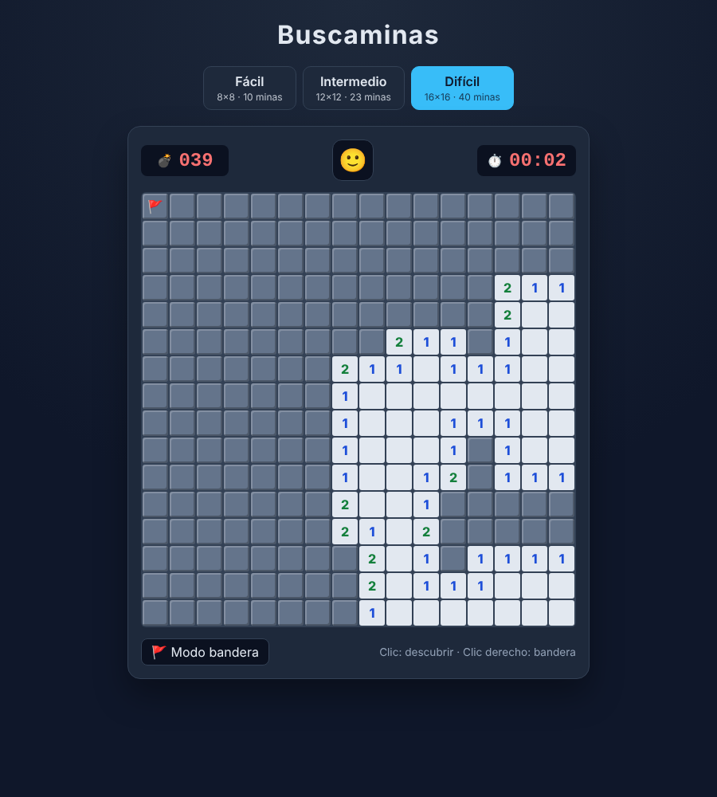

# 💣 Buscaminas en PHP

Réplica del clásico videojuego **Buscaminas** hecha con PHP 8.5, HTML, CSS y JavaScript, sin frameworks ni dependencias externas.

El objetivo es descubrir todas las casillas que no contienen minas. Cada casilla descubierta muestra cuántas minas hay a su alrededor; usa esa información para deducir dónde están y márcalas con una bandera.



## Características

- Tres niveles con tablero creciente y la misma densidad de minas:

  | Nivel | Tablero | Minas |
  |---|---|---|
  | Fácil | 8 × 8 | 10 |
  | Intermedio | 12 × 12 | 23 |
  | Difícil | 16 × 16 | 40 |

- Algoritmo de desborde clásico: al descubrir una casilla vacía se abre toda la zona hasta los números del borde.
- Primer clic siempre seguro.
- Números de colores (1 azul, 2 verde, 3 rojo…).
- Temporizador de la partida y contador de minas restantes.
- Banderas con clic derecho o con el **Modo bandera** en pantallas táctiles.
- Mensaje **«¡Ganaste!»** o **«Perdiste»** al terminar.

## Requisitos

- **PHP 8.5.13** o superior.
- Un servidor web local: [Laravel Herd](https://herd.laravel.com/) o el servidor integrado de PHP.

Consulta [`docs/Tecnologias.md`](docs/Tecnologias.md) para la lista completa.

## Ejecución

### Con Laravel Herd

1. Clona el repositorio dentro de la carpeta que Herd publica:

   ```bash
   git clone https://github.com/<tu-usuario>/Buscaminas.git
   ```

2. Abre `http://buscaminas.test` en el navegador.

### Con el servidor integrado de PHP

```bash
cd Buscaminas
php -S localhost:8000
```

Abre `http://localhost:8000`.

## Pruebas

```bash
php source/tests/run.php
```

## Cómo jugar

1. Elige un nivel.
2. Haz clic en una casilla para descubrirla.
3. Un número indica cuántas minas hay en las 8 casillas que la rodean.
4. Marca con clic derecho las casillas donde creas que hay una mina.
5. Ganas al descubrir todas las casillas sin mina; pierdes si descubres una mina.

## Estructura del proyecto

```
Buscaminas/
├── docs/          Documentación del proyecto
├── source/
│   ├── public/    Página del juego, API y recursos estáticos
│   ├── src/       Código PHP por capas (Domain, Application, Infrastructure, Presentation)
│   └── tests/     Pruebas
├── index.php      Punto de entrada (redirige a source/public)
└── README.md
```

## Documentación

| Documento | Contenido |
|---|---|
| [Tecnologias.md](docs/Tecnologias.md) | Tecnologías y versiones utilizadas |
| [Arquitectura.md](docs/Arquitectura.md) | Arquitectura, algoritmo de desborde, API y decisiones de diseño |

## Licencia

_Por definir._
